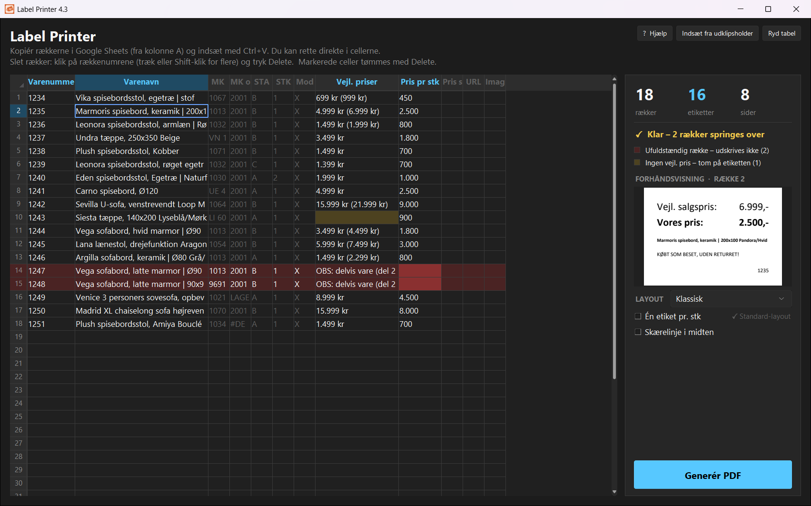
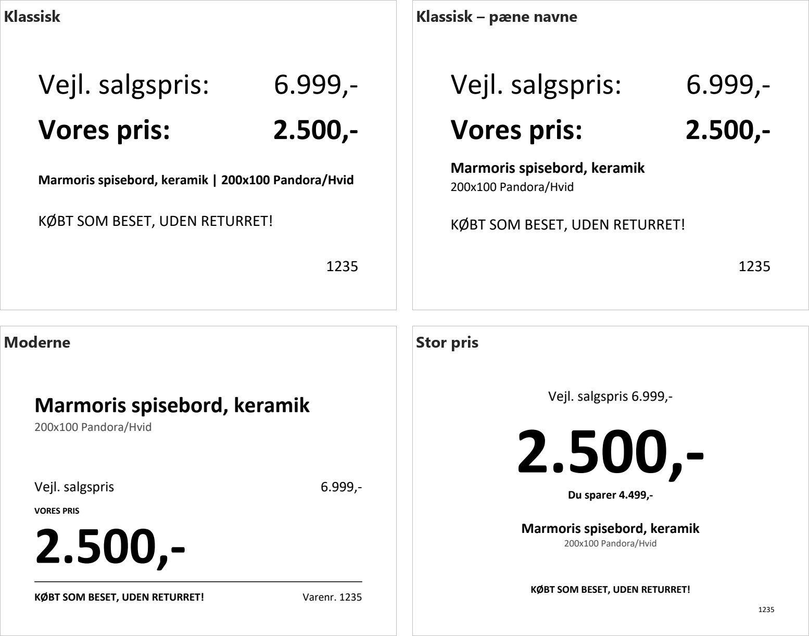

# Label Printer

A small Windows desktop app that turns rows copied from a Google Sheet into printable price labels
for a furniture outlet: paste the rows, check them, and get a PDF with two labels per A4 sheet, ready
to be cut in half.



It is the second half of a two-step workflow. **Label Miner** (a separate repository) reads the labels
on photos of incoming items and fills the shop's Google Sheet; Label Printer prints the price labels
from that sheet.

## Features

- **Paste straight from Google Sheets.** Rows are pasted into a spreadsheet grid in the sheet's column
  order and can be edited in place.
- **Robust price reading.** Prices typed by hand come in many shapes: `1.699 kr`, `~1699`,
  `8.999 kr (11.999 kr)`, `1234 4321`, `OBS: delvis vare (del 1/3)`. The parser handles all of them.
- **Validation you can see.** Incomplete rows are shown in red and skipped, missing recommended
  prices are shown in yellow, and a live preview shows the selected row as it will print.
- **Four layouts.** "Klassisk" reproduces the shop's old hand-made Word labels; the others split
  long product names into a bold title and smaller details.

  
- **Print-ready PDF.** Each label fills exactly half an A4 page. The PDF asks the print dialog to
  default to "actual size", so the cut line stays in the middle.
- **Help built in.** A Danish user manual, generated from screenshots of the real app, opens from
  the "? Hjælp" button.
- **Headless mode** for scripting and testing: `python -m label_printer --paste rows.tsv --out labels.pdf`.

The user interface is in Danish, as the app is used in a Danish shop. Code, comments and docs are
in English.

## Project layout

```
src/label_printer/
  model.py      the Label data class and the sheet's column layout
  parsing.py    prices, rows and product names (pure functions)
  layouts.py    the four label designs, drawn with ReportLab
  pdf.py        the two-labels-per-page PDF and preview images
  settings.py   the user's default layout (%APPDATA%)
  gui.py        the Tkinter window (tksheet grid, preview, options)
  __main__.py   entry point and headless mode
tests/          pytest: parsing, PDF output, layouts, CLI
docs/manual/    generator for the Danish user manual (screenshots + PDF)
packaging/      PyInstaller spec, Inno Setup installer, build script, icon
```

## Getting started

Requires Python 3.10+ on Windows. Everything except the manual's screenshots also works elsewhere.

```powershell
python -m venv .venv
.venv\Scripts\activate
pip install -e .[dev]
python -m label_printer          # start the app
pytest                           # run the tests
ruff check . && ruff format --check .
```

## Building the installer

```powershell
pip install -e .[build]
winget install --id JRSoftware.InnoSetup -e
powershell -File packaging\build.ps1
```

This builds the manual, freezes the app with PyInstaller (`dist\Label-Printer\`) and packages
it with Inno Setup into `build\installer\Label-Printer-Setup.exe`. That is a per-user install with
no admin rights needed, a Danish installer, and in-place upgrades.

## History

The app was built iteratively together with its user; the commit history follows the versions
that were actually used (see [CHANGELOG.md](CHANGELOG.md)). The early versions were a single
script, which was later split into the package above.

## License

[MIT](LICENSE). Third-party licences are listed in [THIRD_PARTY_NOTICES.md](THIRD_PARTY_NOTICES.md).
